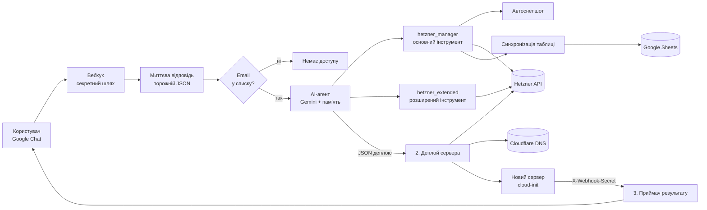
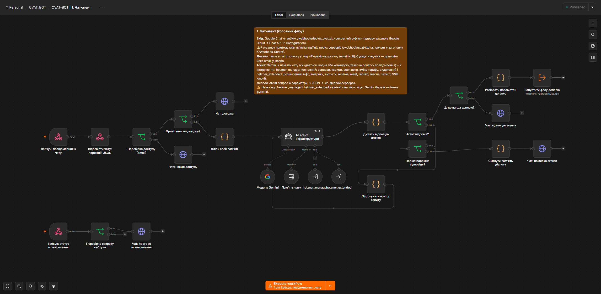
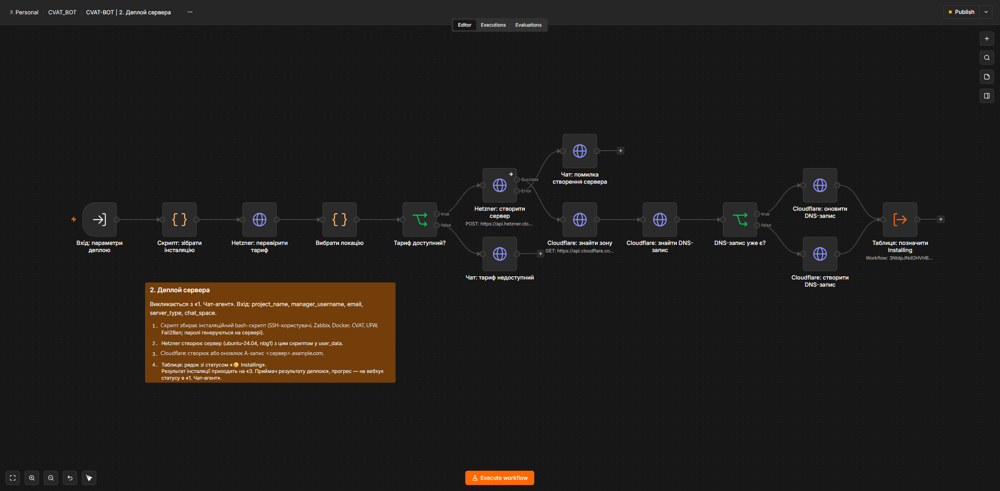
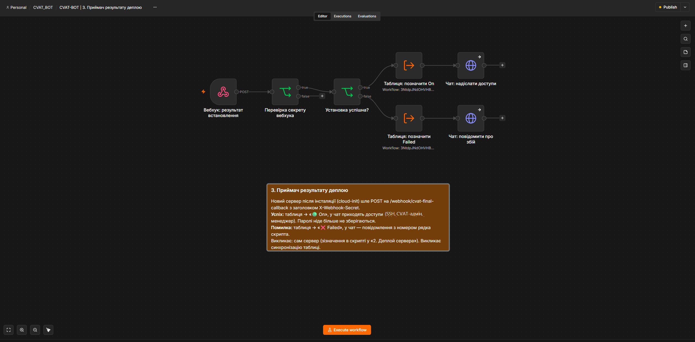
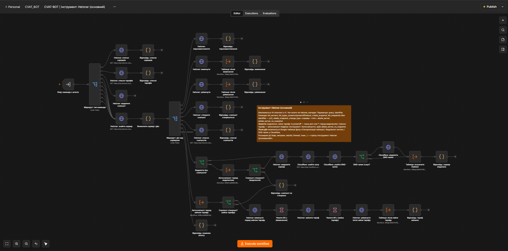
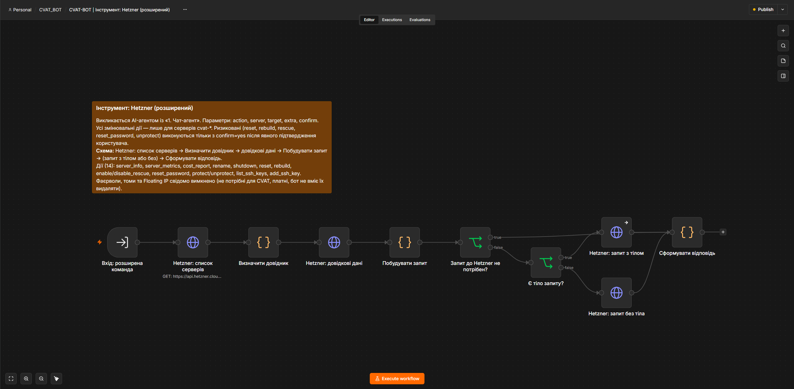
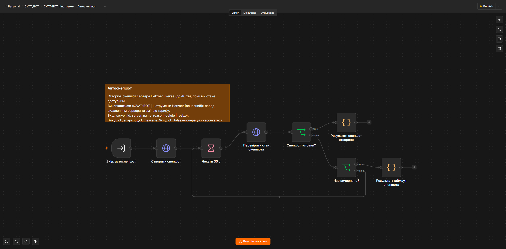
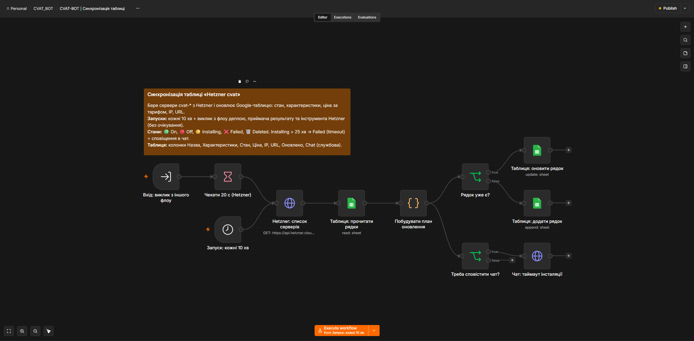

# CVAT ChatOps

> AI-бот у Google Chat для розгортання та керування серверами CVAT у Hetzner. Працює на n8n (Gemini 3 Flash), веде облік у Google Sheets.

## Опис проєкту

Один чат замінює консоль Hetzner для CVAT-серверів. Бот піднімає новий сервер із CVAT за чотирма параметрами, керує живленням, снепшотами, тарифом, видаленням, показує метрики та витрати і сам веде таблицю обліку. Працює цілодобово на self-hosted n8n.

## Архітектурна схема (Data Flow)

## Флоу

| Флоу | Роль |
|---|---|
| 1. Чат-агент | Вхід із Google Chat: перевірка доступу, AI-агент з пам'яттю діалогу, відповіді та прогрес |
| 2. Деплой сервера | Створення сервера Hetzner, вибір локації, DNS у Cloudflare, інсталяційний скрипт |
| 3. Приймач результату деплою | Приймає звіт від нового сервера та надсилає в чат картку з доступами |
| Інструмент: Hetzner (основний) | Список, живлення, снепшоти, зміна тарифу, видалення |
| Інструмент: Hetzner (розширений) | Інформація, метрики, звіт по витратах, rename, reset, rebuild, rescue, захист, SSH-ключі, новий сервер зі знімка |
| Інструмент: Автоснепшот | Снепшот перед небезпечною дією, чекає завершення (до 40 хв) |
| Синхронізація таблиці | Оновлює Google Sheet кожні 10 хв і після дій бота |

### Скриншоти флоу

**1. Чат-агент**

**2. Деплой сервера**

**3. Приймач результату деплою**

**Інструмент: Hetzner (основний)**

**Інструмент: Hetzner (розширений)**

**Інструмент: Автоснепшот**

**Синхронізація таблиці**

## Еволюція: v1 → v2

Репозиторій зберігає історію: перша версія (липень 2026) і повністю перебудована (жовтень 2026).

| | v1 (липень 2026) | v2 (жовтень 2026) |
|---|---|---|
| Модулі | 4: агент, деплой, приймач результату, один інструмент Hetzner | 7 флоу: агент, деплой, приймач, два інструменти (основний і розширений), автоснепшот, синхронізація таблиці |
| Модель агента | за описом v1: GPT-4o через OpenRouter | Gemini 3 Flash |
| Дії в чаті | перезавантаження, живлення, снепшот, зміна тарифу, видалення, деплой | 26 дій: додано rebuild, rescue, reset, метрики, звіт по витратах, захист, SSH-ключі, список тарифів із цінами, новий сервер зі знімка |
| Пам'ять діалогу | PostgreSQL | пам'ять n8n: 20 повідомлень, окрема для кожного чату, `/reset` |
| Облік | n8n Data Tables | Google Sheet: оновлення кожні 10 хвилин і після дій бота |
| Захист від втрат | видалення з очищенням DNS | автоснепшот перед видаленням і зміною тарифу, захист від видалення, ризикові дії лише з підтвердженням у коді |
| Помилки | збій cloud-init іде в чат | те саме, плюс Error Workflow із тикетом у Redmine, повтор запитів на читання, автоповтор при порожній відповіді моделі |

## Ключові можливості

1. **Деплой:** одна фраза з чотирма параметрами (проєкт, email, тариф, логін менеджера), 10–15 хвилин, у чат приходять доступи.
2. **Вибір локації:** бот перевіряє наявність тарифу й сам обирає nbg1, fsn1 або hel1; якщо тарифу ніде немає, деплой не запускається.
3. **26 дій у чаті:** від списку серверів і тарифів із цінами до rebuild, rescue, звіту по витратах і створення нового сервера зі знімка (вимкненим, щоб оглянути диск через rescue).
4. **Захист від втрат:** автоснепшот перед видаленням і зміною тарифу, захист від видалення, ризикові дії лише з підтвердженням у коді.
5. **Облік:** таблиця оновлюється сама (стан, ціна за тарифом, IP, URL), сповіщення про таймаут установки.
6. **Команда `/reset`** на початку повідомлення скидає пам'ять діалогу. Скидається лише пам'ять того чату, з якого надіслано команду.
7. **Довідка:** коротка інструкція (що вміє бот, підтвердження для небезпечних дій, `/reset`) приходить сама, коли бота додають у чат, і за командою `/help`.
8. **Окремий чат для кожного адміністратора:** пам'ять діалогу своя, сервери й таблиця спільні. Бот шукається в Google Chat за назвою `Deploy_CVAT_AI`; доступ дають список email у n8n та видимість застосунку в Google Cloud (до 5 адрес).

## Безпека

- Бот приймає повідомлення лише від email зі списку.
- Адреса вебхука Google Chat має секретний суфікс; вебхуки статусу й результату вимагають заголовок `X-Webhook-Secret`.
- Паролі генеруються на сервері (openssl) і не зберігаються в n8n, таблиці чи метаданих Hetzner. Приходять у чат однією карткою.
- SSH: користувачі `admin1` та `admin2`, root лише за ключем, UFW з довіреними адресами, Fail2Ban.
- Зміни лише для серверів з префіксом `cvat-`.

## Надійність і помилки

- **Error Workflow.** Усі флоу підключались до спільного Error Workflow (у цю копію не входить): коли флоу падає, Gemini коротко пояснює причину, а в системі заявок створюється тикет. Помилки, які бот обробляє сам (наприклад, «сервер не знайдено», тариф недоступний), тикетів не створюють.
- **Повтор при збої мережі.** Запити на читання до Hetzner та Cloudflare (списки, пошук серверів, перевірка тарифу, опитування снепшота) повторюються до 3 разів. Дії, що змінюють стан (створення сервера та снепшота, видалення, зміна тарифу, reset, rebuild), навмисно не повторюються автоматично, щоб не створити дублікат і не показати хибну помилку.
- **Порожня відповідь моделі.** Один автоповтор, потім скидання пам'яті чату.
- Флоу прийому результату деплою не зберігає дані запусків (там паролі).

## Вимоги

- n8n із кредами: Hetzner Cloud (Bearer), Cloudflare, Google Service Account для Chat, Google Sheets OAuth2, Google Gemini (PaLM).
- Google Sheet «Hetzner cvat» з колонками: `Назва | Характеристики | Стан | Ціна | IP | URL | Оновлено | Chat`.

## Як відновити з нуля

1. Імпортувати всі файли з `workflows/` в n8n.
2. Створити креди (див. Вимоги) і прив'язати їх до вузлів.
3. Оновити ID підфлоу в вузлах `executeWorkflow` і тулах агента: після імпорту ID змінюються.
4. Задати у флоу значення секрету вебхука та секретний суфікс шляху вебхука Chat.
5. У Google Cloud (Chat API → Configuration) вказати адресу вебхука.
6. Опублікувати флоу й перевірити: повідомлення «список серверів» у чаті.

## Заглушки в цій копії

Це знеособлена копія робочого проєкту. Реальні значення замінено заглушками, які потрібно підставити:

| Заглушка | Що це |
|---|---|
| `example.com`, `n8n.example.com` | ваш домен у Cloudflare та адреса n8n |
| `admin1@example.com`, `admin2@example.com` | email адміністраторів, яким дозволено писати боту |
| `admin1`, `admin2` | імена SSH-користувачів на нових серверах |
| `<SSH_PUBLIC_KEY>` | публічний SSH-ключ для `admin2` |
| `<MONITORING_SERVER_IP>`, `<TRUSTED_IP>` | сервер Zabbix та довірена адреса для UFW |
| `<HETZNER_SSH_KEY_1>`, `<HETZNER_SSH_KEY_2>` | назви SSH-ключів у проєкті Hetzner |
| `<CREDENTIAL_ID>`, `<SUBWORKFLOW_ID>`, `<GOOGLE_SHEET_ID>` | ID креденшлів, підфлоу й таблиці у вашому n8n |
| `<WEBHOOK_SECRET>`, `<WEBHOOK_PATH_SECRET>` | секрет вебхука та секретний суфікс шляху |

## Структура репозиторію

| Шлях | Що це |
|---|---|
| `workflows/` | Експорт флоу з n8n (секрети замінено заглушками) |
| `docs/` | Скриншоти флоу з n8n |

## Чого тут немає навмисно

- Токенів, паролів і значення `X-Webhook-Secret`. У флоу лише посилання на креди n8n за ID та назвою; секретний суфікс шляху вебхука та значення секрету замінено заглушками.
- Вивантажень таблиці обліку.

## Відомі обмеження

- Вимкнені (Off) сервери Hetzner тарифікуються; бот показує їх у звіті по витратах.
- Gemini іноді повертає порожню відповідь: бот сам один раз повторює запит, а якщо відповідь знову порожня, скидає пам'ять чату й просить повторити повідомлення.
- Агент працює на `gemini-3-flash-preview`. Це preview-модель: Google може змінити або зняти її без попередження. Її обрано, бо `gemini-2.5-flash` частіше повертав порожні відповіді й відмовлявся викликати інструменти після помилки. Якщо бот раптом перестав відповідати, спершу перевірте назву моделі у вузлі «Модель Gemini» і поверніть `models/gemini-2.5-flash` (або іншу стабільну).
- Пам'ять діалогу: останні 20 повідомлень, окрема для кожного чату, скидається щодня або командою `/reset` (лише в чаті, з якого її надіслано). Зберігається в пам'яті n8n і зникає при його перезапуску.
- Rebuild сервера запускає інсталяцію CVAT заново: приходять нові паролі.
- Фаєрволи, томи та Floating IP свідомо не підтримуються.
