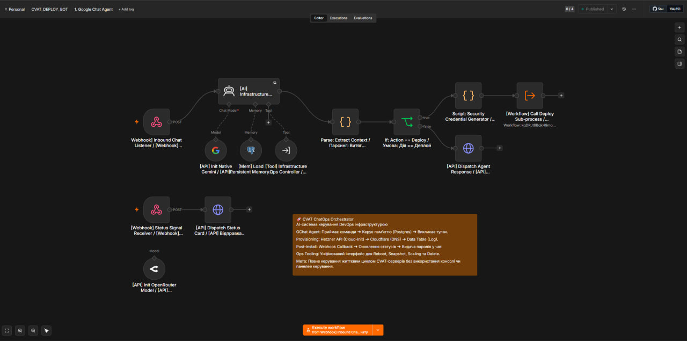
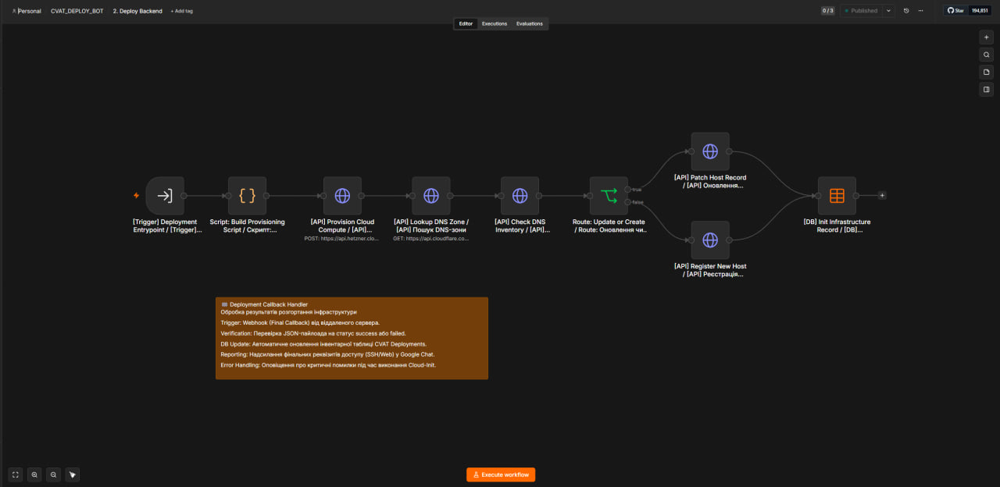
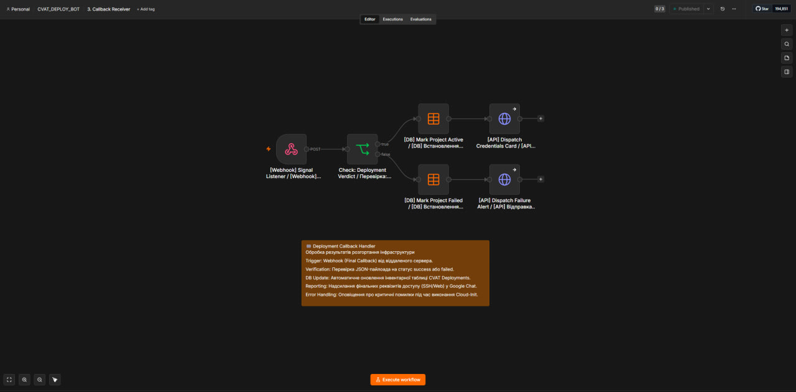
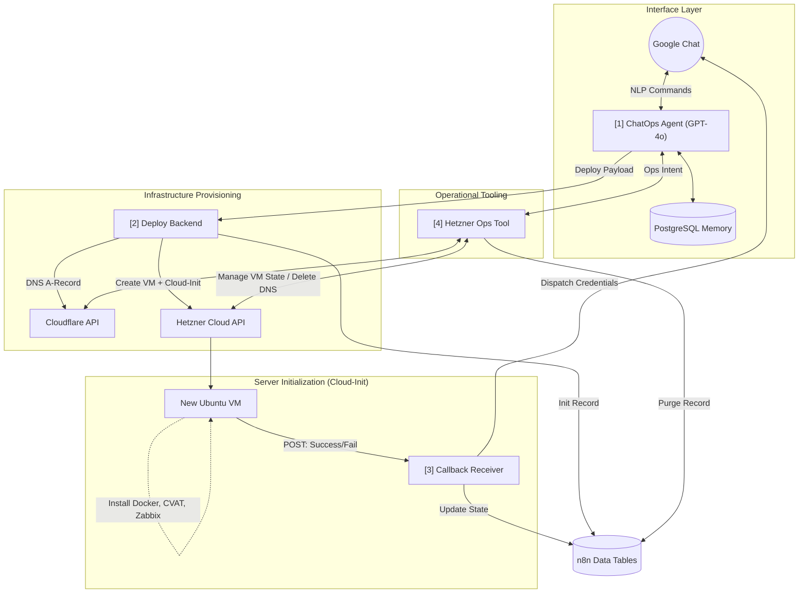

# 🚀 CVAT ChatOps Orchestrator

> Комплексна AI-система на базі n8n для розгортання та керування життєвим циклом DevOps інфраструктури (серверів CVAT) через інтерфейс Google Chat. Бот дозволяє створювати віртуальні машини в Hetzner Cloud, налаштовувати Cloudflare DNS, генерувати безпечні паролі та виконувати операційні задачі без необхідності доступу до консолі управління.

## 📋 Огляд бізнес-контексту

Проєкт реалізує парадигму **ChatOps** (Infrastructure as Chat). Замість ручного створення серверів, налаштування мережі та виконання скриптів ініціалізації, інженер або менеджер просто відправляє команду ШІ-агенту в Google Chat (наприклад, *"Розгорни новий CVAT сервер demo_project на тарифі cpx31"*). 

Агент збирає необхідні параметри, генерує паролі, викликає суб-процес деплою та після автоматичного розгортання надсилає користувачу картку з готовими доступами до веб-інтерфейсу та SSH.

---

## 📈 Мікросервісна архітектура

Система складається з 4 незалежних модулів:

### 1. [ChatOps Agent](./1_chat_agent/)
NLP-інтерфейс. Утримує контекст розмови в PostgreSQL, збирає необхідні параметри для деплою або викликає інструменти керування для існуючих серверів.

### 2. [Deploy Backend (Provisioning)](./2_deploy_backend/)
Виконує фізичне створення інфраструктури. Оновлює Cloudflare DNS та ін'єктує складний Cloud-Init Bash скрипт (Docker, Zabbix, UFW, Fail2Ban) в Hetzner API під час завантаження ВМ.

### 3. [Callback Receiver](./3_callback_receiver/)
Слухач асинхронних подій. Отримує вебхук від самого сервера після успішного або неуспішного завершення Cloud-Init скрипта, оновлює БД та надсилає результати в чат.

### 4. [Hetzner Unified Ops Tool](./4_hetzner_ops_tool/)
Уніфікований інструмент агента для керування існуючою інфраструктурою: Reboot, Power On/Off, створення Snapshot-ів, зміна тарифного плану (Scaling) та повне видалення серверів разом із DNS-записами.

---

## 📊 Архітектура та рух даних (Data Flow)

---

## 🚀 Ключові інженерні рішення

1. **Decoupled Architecture:** Розділення логіки діалогу (Agent) та логіки виконання (Backend) дозволяє агенту не зависати під час довгого процесу розгортання.
2. **Infrastructure as Code (IaC) via n8n:** Сценарій розгортання (Bash/Cloud-Init) динамічно генерується в n8n (зі вставкою паролів, IP та доменів) і передається в Hetzner у форматі Base64.
3. **Secret Management:** Агент ніколи не отримує паролі від користувача. Спеціальний JS-скрипт генерує складні паролі автоматично перед викликом деплою і відправляє їх користувачу лише після успішного встановлення.
4. **Graceful Error Handling:** Cloud-init скрипт на serverі містить `trap 'catch_error $LINENO' ERR`. Якщо встановлення Docker чи CVAT впаде на будь-якому етапі, server відправить POST-запит про помилку в Callback Receiver, і адміністратор миттєво дізнається про це в чаті.
5. **Idempotency & Clean Up:** Інструмент операційного керування вміє повністю очищати сліди сервера — видаляє ВМ з Hetzner, чистить DNS-записи у Cloudflare та маркує запис у внутрішній базі як `Deleted`.

## 🛠 Технологічний стек

* **Оркестрація:** n8n Enterprise (AI Agents, Execute Workflow, Webhooks)
* **Штучний Інтелект:** OpenRouter / Gemini API
* **Cloud Providers:** Hetzner Cloud (Compute), Cloudflare (DNS)
* **Бази даних:** PostgreSQL (Agent Memory), n8n Data Tables (Inventory Log)